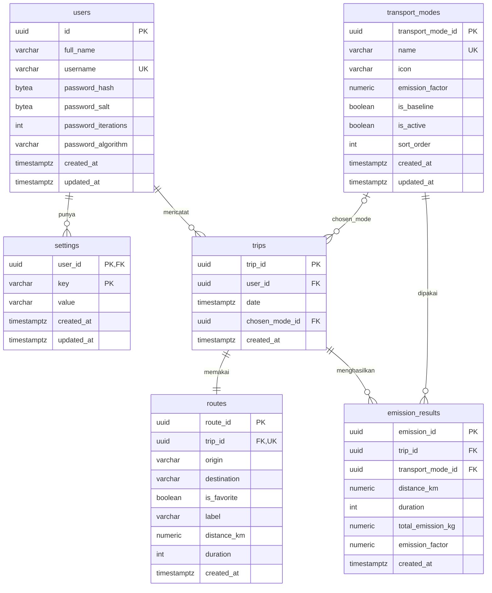

# Perencanaan Database PostgreSQL — CRoute

Dokumen ini memetakan fitur UI yang sudah ada ke skema database PostgreSQL.
Skrip siap pakai ada di:

- `schema.sql` — tabel, constraint, index, seed, trigger, dan view.
- `functions.sql` — function agregasi yang dibutuhkan Dashboard/Statistik.
- `csharp-functions.md` — daftar class/method C# yang perlu dibuat di `CRoute.Data`.
- `supabase.md` — langkah memakai Supabase (connection string, key, role, SSL, RLS).
- `supabase-croute-role.sql` — role `croute` + grant untuk Supabase.
- `migration-minimal-target.sql` — migrasi database lama ke struktur minimal target.
- `migration-chosen-mode.sql` — migrasi `fn_save_trip` agar menerima `chosen_mode_id`
  (versi aman untuk role aplikasi `croute` di Supabase hosted).
- `target-alignment-plan.md` — rencana penyesuaian skema agar ≥70% mirip dengan target
  `ROUTE`/`TRANSPORT_MODE`/`TRIP`/`EMISSION_RESULT`/`SETTING` (multi-user tetap).

> **Catatan Supabase hosted.** Role aplikasi `croute` bukan owner
> `v_trip_summary` maupun function agregasi lama. Karena itu
> `migration-chosen-mode.sql` hanya menambahkan overload
> `fn_save_trip(..., p_chosen_mode_id)` dan view `v_trip_chosen_result`.
> Aplikasi WPF sudah memakai `chosen_mode_id` lewat C#. Supaya function
> agregasi SQL di database hosted juga memakai opsi terpilih, jalankan
> `schema.sql`/`functions.sql` sebagai owner database (mis. lewat Supabase SQL
> Editor dengan role postgres).

## 1. Ringkasan fitur UI → data

| Fitur UI | Yang ditampilkan | Sumber data |
|---|---|---|
| Login | username + password | `users` (`password_hash`, `password_salt`) |
| Register | nama lengkap, username, password | `users` + baris awal `settings` |
| Dashboard — sapaan | nama depan pengguna | `users.full_name` |
| Dashboard — emisi bulan ini | total emisi opsi terpilih bulan berjalan | `fn_current_month_total()` |
| Dashboard — hemat vs mobil | total penghematan seluruh perjalanan | `fn_total_saved()` |
| Dashboard — jumlah perjalanan | count seluruh trip | `fn_trip_count()` |
| Dashboard — target bulanan | total / target, persentase, status | `fn_current_month_total()` + `settings` (`monthly_target_kg`) |
| Dashboard — 3 perjalanan terakhir | rute, tanggal, jarak, moda terpilih, hemat | `fn_recent_trips(3)` |
| Cek Rute — daftar moda | nama, ikon, faktor emisi | `transport_modes` (`is_active = true`) |
| Cek Rute — hasil per bandingan | emisi tiap moda | dihitung lokal; disimpan ke `emission_results` |
| Cek Rute — simpan | satu trip + rute + semua hasil + mode terpilih | `fn_save_trip(..., p_chosen_mode_id)` (atomik) |
| Riwayat | semua trip, urut terbaru | `v_trip_summary` |
| Riwayat — hapus semua | hapus trip milik pengguna | `fn_clear_trips()` |
| Statistik — total bulan ini | sama dengan Dashboard | `fn_current_month_total()` |
| Statistik — progress target | total / target | `fn_monthly_progress()` |
| Statistik — total hemat | seluruh trip | `fn_total_saved()` |
| Statistik — rata-rata per trip | rata-rata emisi opsi terpilih | `fn_average_per_trip()` |
| Statistik — moda favorit | moda terpilih yang paling sering muncul | `fn_favorite_mode()` |
| Statistik — grafik 7 hari | emisi per hari, hari kosong = 0 | `fn_daily_emissions(7)` |

## 2. ERD



## 3. Penjelasan tabel

### `users`
Menyimpan akun. Password **tidak pernah** disimpan mentah:

- `password_hash` = hasil PBKDF2-HMAC-SHA256, 32 byte.
- `password_salt` = salt acak 16 byte.
- `password_iterations` = 100000 (disimpan agar bisa dinaikkan tanpa merusak akun lama).
- `password_algorithm` = `pbkdf2-sha256`.

Username disimpan dalam huruf kecil (dinormalisasi aplikasi), dan tetap diberi
unique index `lower(username)` sebagai pengaman.

### `settings`
Pengaturan generik per pengguna dengan bentuk `key`/`value`, mengikuti
`SETTING` pada rancangan target. Primary key komposit `(user_id, key)` dipakai
karena aplikasi tetap multi-user. Saat user baru dibuat, trigger
`trg_users_default_settings` membuat baris `monthly_target_kg = '15.00'`.

### `transport_modes`
Master moda transportasi. Data awal sama dengan `FakeTransportModeProvider`:

| Nama | Ikon | Faktor (kg CO₂/km) |
|---|---|---|
| Mobil | car | 0.171 |
| Motor | motorcycle | 0.103 |
| Bus | bus | 0.089 |
| Kereta | train | 0.041 |
| Sepeda | bicycle | 0.000 |
| Jalan kaki | walk | 0.000 |

`is_baseline = true` menandai acuan penghematan (Mobil). Unique index parsial
memastikan hanya satu baris baseline. Faktor disimpan di DB supaya nanti bisa
diperbarui dari Climatiq tanpa mengubah kode.

### `trips`
Satu perjalanan yang disimpan pengguna. Relasi ke `users` (cascade saat user
dihapus). `date` adalah waktu kejadian, bukan waktu insert. `chosen_mode_id`
menyimpan moda yang **benar-benar dipakai pengguna** (nullable). Data lama yang
belum punya pilihan dianggap memakai opsi terbaik saat dibaca.

### `routes`
Detail rute milik satu trip. Relasi 1:1 lewat `routes.trip_id UNIQUE`, dengan
`ON DELETE CASCADE`. `is_favorite` dan `label` disiapkan untuk fitur rute
favorit berikutnya. Karena relasi masih 1:1 dengan trip, rute favorit akan ikut
terhapus saat trip dihapus; ini batasan pendekatan minimal.

### `emission_results`
Hasil emisi per moda untuk satu trip. `UNIQUE (trip_id, transport_mode_id)`
mencegah duplikat moda dalam satu trip. `distance_km` dan `duration` disimpan
per hasil sesuai target. `emission_factor` adalah **snapshot** faktor yang
dipakai saat perhitungan, sehingga riwayat lama tidak berubah kalau master
faktor diperbarui.

## 4. Keputusan desain

1. **Multi-user sejak awal.** Walaupun aplikasi desktop, login/register sudah
   ada, jadi semua trip dan target diikat ke `user_id`. Ini juga mencegah data
   satu pengguna terlihat oleh pengguna lain.
2. **Moda transportasi global, target per pengguna.** Daftar moda adalah master
   data aplikasi; target bulanan adalah preferensi masing-masing pengguna.
3. **Snapshot faktor emisi.** Nilai `emission_factor` dari `transport_modes`
   disalin ke `emission_results` agar laporan historis tetap konsisten.
4. **UUID + `gen_random_uuid()`.** Tidak perlu sequence; aman untuk sinkronisasi
   dan tidak membocorkan jumlah data.
5. **Tipe `NUMERIC`, bukan `DOUBLE`.** Perhitungan uang/emisi tidak boleh kena
   galat pembulatan floating point. Jarak `NUMERIC(10,2)`, emisi
   `NUMERIC(12,4)`, faktor `NUMERIC(12,6)`.
6. **Timestamp dengan zona waktu.** `TIMESTAMPTZ` disimpan dalam UTC. Agregasi
   bulan/hari memakai `Asia/Jakarta` agar "bulan ini" dan grafik 7 hari sesuai
   waktu pengguna. Aplikasi harus mengirim UTC (lihat `csharp-functions.md`).
7. **Password PBKDF2 di aplikasi, bukan di database.** Database hanya menyimpan
   hash + salt. Verifikasi dilakukan di C# memakai
   `Rfc2898DeriveBytes.Pbkdf2`, sama seperti `FakeAuthService` sekarang.
8. **Agregat tersedia di SQL, saat ini dihitung di C#.** Function SQL sudah
   disiapkan untuk Dashboard/Statistik, tetapi implementasi WPF sekarang memuat
   `GetHistory()` dan menghitung di memori memakai `Trip.GetChosenOption()`
   (fallback opsi terbaik untuk data lama). Function SQL memakai kolom
   `chosen_*` yang sama, jadi hasilnya konsisten saat nanti dipindahkan ke DB.
9. **Session tidak disimpan di database.** Aplikasi desktop menyimpan user yang
   sedang login di memori (`IAuthService`). Kalau nanti ada API/server, baru
   tambahkan tabel `sessions` atau refresh token.
10. **Skema `public`.** Untuk kesederhanaan. Kalau ingin lebih rapi, semua objek
    bisa dipindah ke schema `croute`.

## 5. Index dan performa

| Index | Kegunaan |
|---|---|
| `users_username_unique_ci` (`lower(username)`) | login & cek username, case-insensitive |
| `trips_user_date_idx` (`user_id`, `date DESC`) | riwayat, recent trip, agregasi per bulan |
| `trips_chosen_mode_idx` (`chosen_mode_id`) | analitik mode terpilih |
| `routes_favorite_idx` (`is_favorite`) partial | daftar rute favorit |
| `emission_results_trip_idx` (`trip_id`) | ambil hasil per trip |
| `emission_results_mode_idx` (`transport_mode_id`) | statistik moda favorit |
| `transport_modes_one_baseline` (partial) | hanya satu baseline |
| `transport_modes_name_key` (unique) | cegah nama moda ganda |

Untuk data satu pengguna, query sudah efisien. Kalau nanti data sangat besar,
`v_trip_summary` bisa diubah menjadi materialized view dan di-refresh setelah
simpan/hapus trip.

## 6. Cara menjalankan skrip

### Opsi A — Docker (paling cepat)

```powershell
docker run --name croute-pg `
  -e POSTGRES_PASSWORD=postgres `
  -e POSTGRES_DB=croute `
  -p 5432:5432 `
  -d postgres:16

# tunggu ±3 detik, lalu:
psql "host=localhost port=5432 dbname=croute user=postgres password=postgres" -f docs/database/schema.sql
psql "host=localhost port=5432 dbname=croute user=postgres password=postgres" -f docs/database/functions.sql
```

### Opsi B — PostgreSQL lokal / pgAdmin

1. Buat database `croute`.
2. Jalankan `schema.sql`.
3. Jalankan `functions.sql`.

### Opsi C — database yang sudah memakai schema lama

Jalankan migrasi satu kali, lalu function versi baru:

```powershell
psql $env:CROUTE_DB_CONNECTION -f docs/database/migration-minimal-target.sql
psql $env:CROUTE_DB_CONNECTION -f docs/database/functions.sql
```

Migrasi akan mengganti nama kolom lama ke nama target dan menambah kolom baru.
Tabel lama `user_settings` dipertahankan untuk keamanan; setelah aplikasi diuji,
boleh dihapus manual.

### Cek hasil

```sql
-- moda awal
SELECT name, emission_factor, is_baseline FROM transport_modes ORDER BY sort_order;

-- akun demo (opsional, lihat schema.sql)
SELECT username, full_name FROM users;

-- login demo: username demo / password demo123
```

## 7. Akun demo

`schema.sql` menyertakan akun demo opsional:

- Username: `demo`
- Password: `demo123`

Hash-nya dibuat dengan PBKDF2-HMAC-SHA256, 100000 iterasi, salt
`000102030405060708090a0b0c0d0e0f`, sehingga cocok dengan cara verifikasi
`FakeAuthService`. Kalau tidak ingin akun demo di database produksi, hapus blok
`INSERT INTO users` di bagian akhir `schema.sql`.

## 8. Implementasi C#

Skrip SQL ini adalah **sumber kebenaran skema**. Implementasi saat ini ada di
`CRoute.Data` dan memakai **Npgsql murni (ADO.NET)**, bukan EF Core:

- `PostgresAuthService` — login/register dengan PBKDF2.
- `PostgresTransportModeProvider` — master moda dari `transport_modes`.
- `PostgresTripHistoryRepository` — riwayat, simpan trip, target, clear.
- `App.xaml.cs` — wiring; route/emisi masih fake.

EF Core tetap menjadi opsi kalau nanti ingin memakai migration/entity. Kalau
memilih EF Core, gunakan `Npgsql.EntityFrameworkCore.PostgreSQL` dan lihat
`csharp-functions.md`; jangan jalankan `schema.sql` dan migration untuk tabel
yang sama.

## 9. Rencana pengembangan berikutnya

- Tabel `favorite_locations` kalau nanti ada fitur lokasi favorit.
- Tabel `sessions`/`refresh_tokens` kalau aplikasi berubah menjadi client-server.
- Kolom `source` di `transport_modes` (`seed`/`climatiq`) dan `last_synced_at`.
- Materialized view untuk statistik kalau jumlah trip sudah sangat banyak.
- Fitur hapus satu trip: cukup `DELETE FROM trips WHERE id = ... AND user_id = ...`
  (rute dan hasil emisi ikut terhapus karena cascade).
