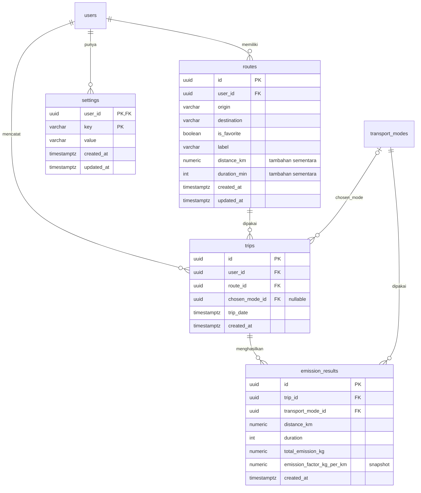

# Rencana Penyesuaian Skema ke Target (minimal 70%)

> **Keputusan proyek: pendekatan minimal.**
> Relasi `routes.trip_id` → `trips.trip_id` **tetap seperti sekarang** (tidak
> dibalik menjadi `trips.route_id`). Yang diimplementasikan: `routes.is_favorite`,
> `routes.label`, `trips.chosen_mode_id`, `emission_results.distance_km`,
> `emission_results.duration`, dan `settings(key, value)`. Nama kolom yang
> sama mengikuti tabel target (`transport_mode_id`, `icon`, `emission_factor`,
> `trip_id`, `date`, `emission_id`, `route_id`).
>
> Bagian rencana penuh di bawah (membalik relasi route–trip) disimpan sebagai
> opsi pengembangan berikutnya, bukan implementasi saat ini.

Dokumen ini merencanakan perubahan database CRoute agar selaras dengan target
`ROUTE`, `TRANSPORT_MODE`, `TRIP`, `EMISSION_RESULT`, dan `SETTING`, dengan
batasan:

- **Multi-user tetap dipertahankan.**
- **`is_favorite` wajib ada** untuk fitur rute favorit berikutnya.
- Target kemiripan: **minimal 70%**.
- Google Maps/Climatiq tidak termasuk dalam rencana ini.

## Status implementasi minimal

| Target | Status aktual |
|---|---|
| `ROUTE.route_id/origin/destination/is_favorite/label` | ✅ (relasi tetap `routes.trip_id`; `distance_km`/`duration` tambahan) |
| `TRANSPORT_MODE.transport_mode_id/name/emission_factor/icon` | ✅ nama kolom mengikuti target |
| `TRIP.trip_id/date/chosen_mode_id` | ✅ |
| `TRIP.route_id` | ❌ belum ada (relasi masih `routes.trip_id`) |
| `EMISSION_RESULT.emission_id/trip_id/transport_mode_id/distance_km/duration/total_emission_kg` | ✅ |
| `SETTING.key/value` | ✅ `settings(user_id, key, value)` |

Perkiraan kemiripan aktual: **~75–80%** (batas 70% terpenuhi).

## 1. Ringkasan hasil

| Aspek | Sekarang | Setelah rencana |
|---|---|---|
| Tabel target yang punya padanan | 5/5 | 5/5 |
| Kolom target yang tersedia (secara makna) | ±13/21 (~62%) | **21/21 (100%)** |
| Relasi utama yang sesuai target | 3/5 | **5/5** |
| Perkiraan kemiripan | ~60% | **~90–95%** |

Dengan rencana ini, batas **70% terlampaui dengan margin**. Kolom tambahan
untuk multi-user (`user_id`) tetap ada dan tidak menghilangkan kolom target.

## 2. Keputusan desain

1. **`ROUTE` menjadi induk `TRIP`.**
   - Sekarang: `routes.trip_id` → `trips.id` (satu rute hanya untuk satu trip).
   - Target: `trips.route_id` → `routes.id` (satu rute bisa dipakai banyak trip).
2. **`routes` mendapat `user_id`, `is_favorite`, dan `label`.**
   - `user_id` adalah tambahan multi-user.
   - `is_favorite` dan `label` mengikuti target.
3. **`trips` mendapat `route_id` dan `chosen_mode_id`.**
   - `chosen_mode_id` nullable, diisi moda yang benar-benar dipakai pengguna.
     Kalau null (data lama), pembacaan memakai opsi terbaik sebagai fallback.
4. **`emission_results` mendapat `distance_km` dan `duration`.**
   - Target menyimpan jarak/durasi per hasil emisi (per mode).
   - `routes.distance_km`/`duration_min` tetap dipertahankan sementara sebagai
     kolom tambahan agar perhitungan baseline dan model `Route` yang sekarang
     tidak langsung rusak.
5. **`SETTING` diganti menjadi tabel `settings(user_id, key, value)`.**
   - Target memakai `key` sebagai PK; karena multi-user, PK dibuat komposit
     `(user_id, key)`.
   - `user_settings.monthly_target_kg` dimigrasikan ke
     `settings('monthly_target_kg')`.
6. **`transport_modes` tidak diubah namanya.**
   - Secara makna sudah cocok: `id`, `name`, `emission_factor_kg_per_km`,
     `icon_name`.
   - Kolom tambahan `is_baseline`, `is_active`, `sort_order`, timestamp tetap.

## 3. ERD setelah perubahan



## 4. Perubahan per tabel

### 4.1 `routes`

Tambahan:

```sql
ALTER TABLE routes
    ADD COLUMN user_id     UUID,
    ADD COLUMN is_favorite BOOLEAN NOT NULL DEFAULT FALSE,
    ADD COLUMN label       VARCHAR(100);

UPDATE routes r
SET user_id = t.user_id
FROM trips t
WHERE t.id = r.trip_id;

ALTER TABLE routes ALTER COLUMN user_id SET NOT NULL;
ALTER TABLE routes
    ADD CONSTRAINT routes_user_id_fkey
    FOREIGN KEY (user_id) REFERENCES users(id) ON DELETE CASCADE;

CREATE INDEX routes_user_favorite_idx
    ON routes (user_id, is_favorite)
    WHERE is_favorite;
```

Setelah `trips.route_id` terisi, hapus relasi lama:

```sql
ALTER TABLE routes DROP COLUMN trip_id;
```

> `distance_km` dan `duration_min` tetap ada sebagai kolom tambahan. Target
> tidak memilikinya di `ROUTE`, tetapi kolom ini dipakai untuk baseline dan
> agar kode C# yang sekarang tetap berjalan.

### 4.2 `trips`

Tambahan:

```sql
ALTER TABLE trips
    ADD COLUMN route_id       UUID,
    ADD COLUMN chosen_mode_id UUID;

UPDATE trips t
SET route_id = r.id
FROM routes r
WHERE r.trip_id = t.id;

ALTER TABLE trips ALTER COLUMN route_id SET NOT NULL;

ALTER TABLE trips
    ADD CONSTRAINT trips_route_id_fkey
    FOREIGN KEY (route_id) REFERENCES routes(id) ON DELETE RESTRICT;

ALTER TABLE trips
    ADD CONSTRAINT trips_chosen_mode_id_fkey
    FOREIGN KEY (chosen_mode_id) REFERENCES transport_modes(id) ON DELETE SET NULL;

-- Isi chosen_mode_id dari hasil emisi terendah.
UPDATE trips t
SET chosen_mode_id = (
    SELECT er.transport_mode_id
    FROM emission_results er
    WHERE er.trip_id = t.id
    ORDER BY er.total_emission_kg ASC, er.created_at ASC, er.id ASC
    LIMIT 1
);
```

`user_id` tetap dipertahankan sebagai tambahan multi-user.

### 4.3 `emission_results`

Tambahan:

```sql
ALTER TABLE emission_results
    ADD COLUMN distance_km NUMERIC(8,2) NOT NULL DEFAULT 0,
    ADD COLUMN duration    INTEGER       NOT NULL DEFAULT 0;

UPDATE emission_results er
SET distance_km = r.distance_km,
    duration    = r.duration_min
FROM trips t
JOIN routes r ON r.trip_id = t.id
WHERE er.trip_id = t.id;
```

`emission_factor_kg_per_km` tetap dipertahankan sebagai snapshot historis.
`UNIQUE (trip_id, transport_mode_id)` tetap.

### 4.4 `settings`

Tabel baru:

```sql
CREATE TABLE settings (
    user_id    UUID         NOT NULL REFERENCES users(id) ON DELETE CASCADE,
    key        VARCHAR(50)  NOT NULL,
    value      VARCHAR(255) NOT NULL,
    created_at TIMESTAMPTZ  NOT NULL DEFAULT now(),
    updated_at TIMESTAMPTZ  NOT NULL DEFAULT now(),
    PRIMARY KEY (user_id, key)
);

CREATE TRIGGER trg_settings_updated_at
    BEFORE UPDATE ON settings
    FOR EACH ROW EXECUTE FUNCTION fn_set_updated_at();
```

Migrasi target bulanan:

```sql
INSERT INTO settings (user_id, key, value)
SELECT user_id, 'monthly_target_kg', monthly_target_kg::text
FROM user_settings
ON CONFLICT (user_id, key) DO UPDATE
SET value = EXCLUDED.value,
    updated_at = now();
```

`user_settings` dapat dihapus setelah function dan trigger tidak lagi
memakainya. Jika ingin masa transisi, biarkan dulu sebagai tabel lama selama
satu rilis.

## 5. View dan function yang harus diubah

### 5.1 `v_trip_summary`

Arah join diubah dari `r.trip_id = t.id` menjadi `r.id = t.route_id`:

```sql
FROM trips t
JOIN routes r ON r.id = t.route_id
LEFT JOIN v_trip_best_result b ON b.trip_id = t.id
LEFT JOIN transport_modes tm ON tm.id = b.transport_mode_id
LEFT JOIN LATERAL (
    SELECT emission_factor_kg_per_km
    FROM transport_modes
    WHERE is_baseline AND is_active
    LIMIT 1
) bm ON TRUE
```

Kolom `distance_km`/`duration_min` masih diambil dari `routes` agar kontrak
view dan ViewModel tidak berubah. `emission_results.distance_km`/`duration`
disiapkan untuk kebutuhan per-mode di masa depan.

### 5.2 `fn_save_trip`

Perubahan logika:

1. Jika `p_route_id` null, buat baris `routes` baru dengan
   `user_id`, `origin`, `destination`, `distance_km`, `duration_min`,
   `is_favorite = false`, `label = null`.
2. Jika `p_route_id` diisi, validasi bahwa rute milik `p_user_id`.
3. Insert `trips` dengan `route_id` dan `chosen_mode_id`.
4. Insert `emission_results` dengan `distance_km` dan `duration` per hasil.
   Nilai diambil dari item JSON; kalau tidak ada, fallback ke
   `p_distance_km`/`p_duration_min`.
5. Kalau `p_chosen_mode_id` null, hitung mode terbaik dari hasil yang baru
   dimasukkan dan update `trips.chosen_mode_id` sebagai fallback data lama.

Signature yang disarankan:

```sql
DROP FUNCTION IF EXISTS fn_save_trip(UUID, TEXT, TEXT, NUMERIC, INTEGER, JSONB, TIMESTAMPTZ);

CREATE OR REPLACE FUNCTION fn_save_trip(
    p_user_id       UUID,
    p_origin        TEXT,
    p_destination   TEXT,
    p_distance_km   NUMERIC,
    p_duration_min  INTEGER,
    p_results       JSONB,
    p_trip_date     TIMESTAMPTZ DEFAULT now(),
    p_route_id      UUID        DEFAULT NULL,
    p_chosen_mode_id UUID       DEFAULT NULL
) RETURNS UUID
...
```

Contoh item `p_results`:

```json
[
  {
    "transport_mode_id": "...",
    "total_emission_kg": 2.12,
    "emission_factor_kg_per_km": 0.171,
    "distance_km": 12.4,
    "duration": 27
  }
]
```

### 5.3 `fn_clear_trips`

Hapus trip; rute tidak otomatis terhapus karena sekarang rute adalah induk.
Untuk menjaga data tetap bersih:

```sql
DELETE FROM trips WHERE user_id = p_user_id;
GET DIAGNOSTICS v_count = ROW_COUNT;

-- Hapus rute orphan yang bukan favorit.
DELETE FROM routes r
WHERE r.user_id = p_user_id
  AND NOT r.is_favorite
  AND NOT EXISTS (SELECT 1 FROM trips t WHERE t.route_id = r.id);

RETURN v_count;
```

Rute favorit tetap tersimpan.

### 5.4 `fn_get_monthly_target` / `fn_set_monthly_target`

Ganti sumber data dari `user_settings` ke `settings`:

```sql
-- get
SELECT COALESCE((
    SELECT s.value::numeric
    FROM settings s
    WHERE s.user_id = p_user_id AND s.key = 'monthly_target_kg'
), 0)::NUMERIC(10,2);

-- set
INSERT INTO settings (user_id, key, value)
VALUES (p_user_id, 'monthly_target_kg', p_target::text)
ON CONFLICT (user_id, key) DO UPDATE
SET value = EXCLUDED.value,
    updated_at = now();
```

### 5.5 Trigger default settings

```sql
CREATE OR REPLACE FUNCTION fn_users_create_default_settings()
RETURNS TRIGGER
LANGUAGE plpgsql
AS $$
BEGIN
    INSERT INTO settings (user_id, key, value)
    VALUES (NEW.id, 'monthly_target_kg', '15.00')
    ON CONFLICT (user_id, key) DO NOTHING;

    RETURN NEW;
END;
$$;
```

### 5.6 Function favorit (untuk fitur berikutnya)

```sql
CREATE OR REPLACE FUNCTION fn_set_route_favorite(
    p_user_id UUID,
    p_route_id UUID,
    p_is_favorite BOOLEAN
) RETURNS BOOLEAN
LANGUAGE plpgsql
AS $$
BEGIN
    UPDATE routes
    SET is_favorite = p_is_favorite,
        updated_at  = now()
    WHERE id = p_route_id AND user_id = p_user_id;

    RETURN FOUND;
END;
$$;
```

## 6. Dampak ke C#

### `PostgresTripHistoryRepository`

- Query `GetHistory`:
  - join `routes r ON r.id = t.route_id` (bukan `r.trip_id = t.id`);
  - `origin`, `destination`, `distance_km`, `duration_min` tetap diambil dari
    `routes` untuk model `Route` yang sekarang.
- `AddTrip`:
  - panggil `fn_save_trip` dengan `chosen_mode_id = trip.GetChosenOption()?.Mode.Id`
    (atau `trip.ChosenModeId`); UI mewajibkan pilihan sebelum simpan;
  - JSON hasil boleh menyertakan `distance_km`/`duration`.
- `SetMonthlyTarget` dan `ClearTrips`: signature function tidak berubah, jadi
  kode C# tidak perlu diubah selain penyesuaian di atas.

### Model `CRoute.Core` (tahap fitur favorit)

Saat fitur favorit dikerjakan:

```csharp
public class Route
{
    // ... field yang sudah ada
    public bool IsFavorite { get; set; }
    public string? Label { get; set; }
}
```

`Trip` juga bisa ditambah `Guid? ChosenModeId` atau referensi mode terpilih
kalau UI perlu menampilkan pilihan eksplisit.

### `PostgresTransportModeProvider` dan `PostgresAuthService`

Tidak perlu diubah kalau nama kolom `transport_modes` dan `users` tetap.

## 7. Urutan migrasi yang disarankan

1. **Backup database.**
2. **Buat tabel `settings`** dan migrasikan target bulanan.
3. **Tambah kolom `routes.user_id`, `routes.is_favorite`, `routes.label`.**
4. **Backfill `routes.user_id`** dari `trips.user_id`.
5. **Tambah `trips.route_id` dan `trips.chosen_mode_id`.**
6. **Backfill `trips.route_id`** dari `routes.trip_id`.
7. **Backfill `trips.chosen_mode_id`** dari hasil emisi terendah.
8. **Tambah `emission_results.distance_km` dan `duration`.**
9. **Backfill dari `routes`.**
10. **Drop view `v_trip_summary`** (dan function yang bergantung jika perlu).
11. **Drop `routes.trip_id`.**
12. **Buat ulang view dan function** dengan arah join baru.
13. **Ganti `fn_get_monthly_target`/`fn_set_monthly_target` dan trigger**
    ke `settings`; drop `user_settings` setelah aman.
14. **Uji C#** dan query agregasi.

Semua langkah sebaiknya dalam satu transaksi saat migrasi awal, kecuali
`DROP` yang membutuhkan commit bertahap di lingkungan produksi.

## 8. Perhitungan kemiripan setelah rencana

| Tabel target | Kolom target | Setelah rencana |
|---|---|---|
| `ROUTE` | `route_id`, `origin`, `destination`, `is_favorite`, `label` | 5/5 (ID dipetakan ke `routes.id`) |
| `TRANSPORT_MODE` | `transport_mode_id`, `name`, `emission_factor`, `icon` | 4/4 secara makna (nama kolom sedikit berbeda) |
| `TRIP` | `trip_id`, `date`, `route_id`, `chosen_mode_id` | 4/4 (tanggal dipetakan ke `trip_date`) |
| `EMISSION_RESULT` | `emission_id`, `trip_id`, `transport_mode_id`, `distance_km`, `duration`, `total_emission_kg` | 6/6 |
| `SETTING` | `key`, `value` | 2/2 (PK komposit karena multi-user) |

**Total: 21/21 kolom target tersedia secara makna (100%)**, dengan tambahan
multi-user dan kolom pendukung. Relasi target juga terpenuhi:

- `TRIP.route_id` → `ROUTE` ✅
- `TRIP.chosen_mode_id` → `TRANSPORT_MODE` ✅
- `EMISSION_RESULT.trip_id` → `TRIP` ✅
- `EMISSION_RESULT.transport_mode_id` → `TRANSPORT_MODE` ✅
- `SETTING` dapat diakses per user ✅

Perkiraan konservatif: **90–95% kemiripan semantik**, jauh di atas 70%.

## 9. Penyimpangan yang disengaja

| Penyimpangan | Alasan |
|---|---|
| `routes.user_id`, `trips.user_id`, `settings.user_id` | Multi-user dipertahankan |
| `settings` PK komposit `(user_id, key)` | Target memakai `key` tunggal, tetapi multi-user butuh pemisahan per user |
| `transport_modes` nama kolom `emission_factor_kg_per_km`/`icon_name` | Tidak perlu rename; makna sama. Bisa dibuat view alias kalau penilaian menuntut nama persis |
| `routes.distance_km`/`duration_min` masih ada | Kompatibilitas dengan model `Route` dan perhitungan baseline saat ini |
| `emission_results.emission_factor_kg_per_km` | Snapshot historis, tidak ada di target tetapi bermanfaat |
| Timestamp/created_at/updated_at | Audit data, tidak ada di target |

Kalau penilaian memakai **nama tabel/kolom persis**, tambahan opsi:

- Rename `transport_modes.icon_name` → `icon` dan
  `emission_factor_kg_per_km` → `emission_factor`.
- Rename `trips.trip_date` → `date`.
- Buat compatibility view `route`, `transport_mode`, `trip`,
  `emission_result`, `setting` dengan nama kolom target. Namun, aplikasi tetap
  memakai tabel asli agar tidak perlu mengubah semua query C#.

## 10. Risiko dan mitigasi

| Risiko | Mitigasi |
|---|---|
| Backfill `routes.user_id` gagal karena ada rute tanpa trip | Rute selalu dibuat bersama trip saat ini; validasi dengan query `NOT EXISTS` sebelum `SET NOT NULL` |
| `DROP routes.trip_id` memutus view/function | Drop/recreate `v_trip_summary` dan function terkait dalam transaksi yang sama |
| `chosen_mode_id` tidak konsisten dengan hasil emisi | Validasi di `fn_save_trip` bahwa moda pilihan ada di `emission_results`; fallback ke hasil terendah hanya kalau null |
| `distance_km`/`duration` dobel di `routes` dan `emission_results` | Jadikan `routes` sebagai nilai default; `emission_results` sebagai nilai per-mode; hapus nanti setelah UI mendukung per-mode |
| `settings.value` berupa teks | Validasi angka di `fn_set_monthly_target`; cast dengan aman |
| Rute favorit terhapus saat clear | `fn_clear_trips` hanya menghapus rute orphan non-favorit |
| Multi-user vs target single-user | `user_id` dipertahankan; dokumentasikan sebagai ekstensi yang disengaja |

## 11. Checklist implementasi

- [ ] Backup database.
- [ ] Tambah `settings` dan migrasikan `monthly_target_kg`.
- [ ] Tambah `routes.user_id`, `is_favorite`, `label`.
- [ ] Tambah `trips.route_id`, `chosen_mode_id`.
- [ ] Tambah `emission_results.distance_km`, `duration`.
- [ ] Backfill semua kolom baru.
- [ ] Ubah `v_trip_summary` dan `fn_save_trip`.
- [ ] Ubah function target/settings dan trigger.
- [ ] Ubah query `PostgresTripHistoryRepository`.
- [ ] Uji login, simpan trip, riwayat, target, clear, favorit.
- [ ] Verifikasi 21/21 kolom target dan 5/5 relasi.
